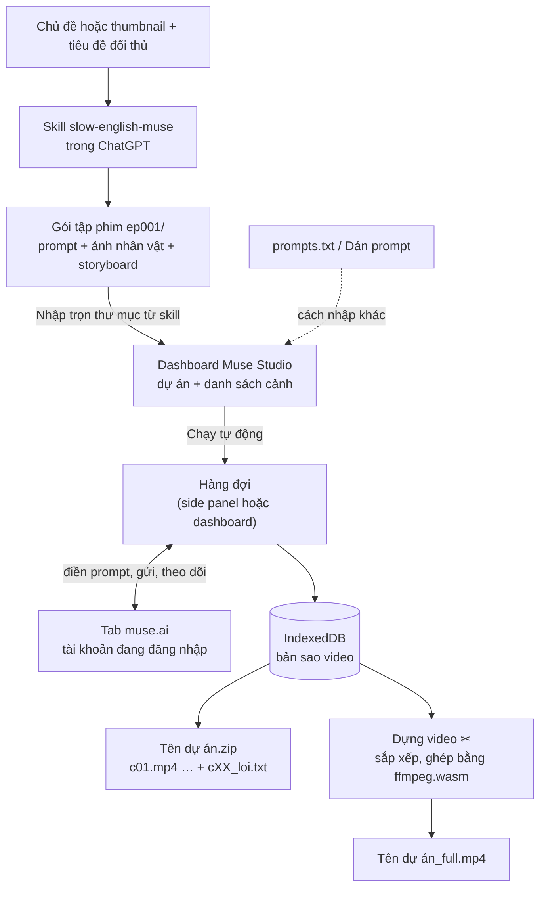
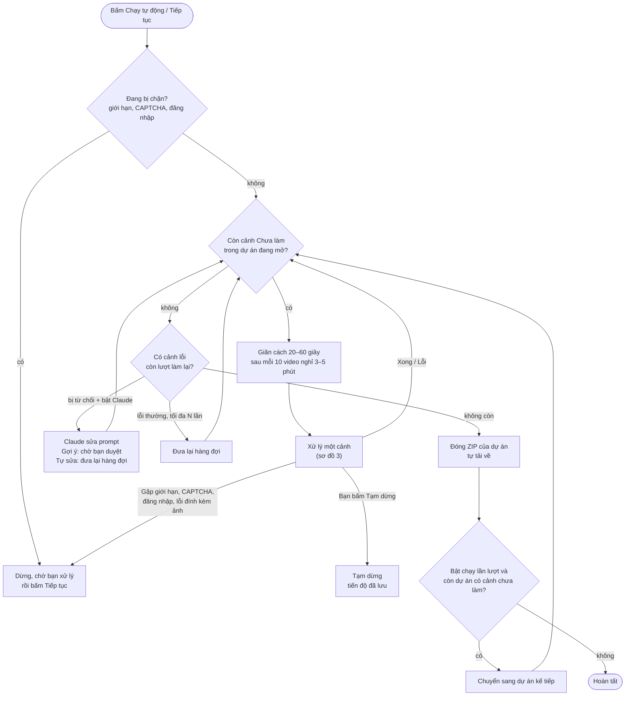
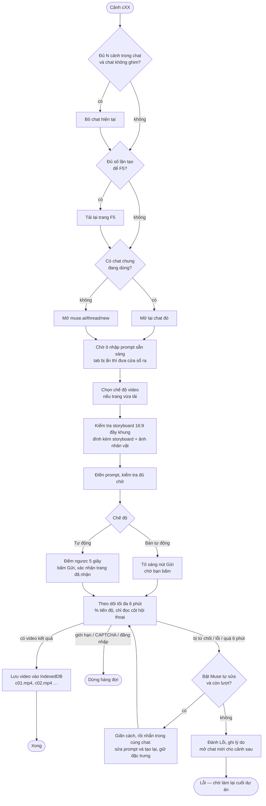

# Muse Auto

Extension Chrome (Manifest V3) giúp tạo video hàng loạt bằng Muse AI trên **chính tài khoản đang đăng nhập** của bạn tại muse.ai.

- Chỉ dùng **một** tài khoản, là tài khoản đang đăng nhập. Extension không đăng nhập, không đọc mật khẩu, không đổi tài khoản.
- Giãn cách giống người dùng thật: chờ ngẫu nhiên **20–60 giây** giữa hai video, cứ sau **10 video** thì nghỉ **3–5 phút**. Phần Cài đặt chỉ cho phép đặt thời gian chờ dài hơn, không cho ngắn hơn.
- Khi trang báo giới hạn, hết hạn mức hoặc "try again later", hàng đợi **dừng ngay**. Nó chỉ chạy lại khi bạn bấm **Tiếp tục**.
- Khi gặp CAPTCHA, bước xác minh hoặc yêu cầu đăng nhập, extension **dừng và báo** cho bạn. Nó không bao giờ tự giải.
- Không gửi dữ liệu tới máy chủ nào khác ngoài trang muse.ai, trừ khi bạn tự bật tính năng "Claude sửa prompt" (gửi tới api.anthropic.com, xem mục bên dưới). Mọi dữ liệu nằm trong `chrome.storage.local` và IndexedDB trên máy bạn.
- Quyền: `sidePanel`, `storage`, `downloads`, `scripting`, `activeTab`. Quyền truy cập trang chỉ cấp cho `muse.ai`.

> ⚠️ **Lưu ý quan trọng:** phiên bản này được viết **khi chưa khảo sát trực tiếp** giao diện muse.ai, vì công cụ viết mã không truy cập được trình duyệt. Các selector trong `content/selectors.js` là phỏng đoán theo aria-label, role và văn bản hiển thị. **Trước khi chạy thật, hãy dùng nút "Khảo sát trang"** (xem mục 4) rồi sửa `selectors.js` nếu cần.

## Skill ChatGPT đi kèm: Slow English Story → Muse

Thư mục [`Skill/`](Skill/) có skill **slow-english-muse** dùng trong ChatGPT. Skill lên kịch bản, nhân vật và storyboard cho phim hoạt hình Slow English (trẻ 3–7 tuổi), rồi xuất gói thư mục để nhập vào dashboard bằng nút **Nhập trọn thư mục từ skill**. Hướng dẫn cài và dùng: [Skill/README.md](Skill/README.md).

## Sơ đồ luồng chạy

### 1. Toàn cảnh: từ ý tưởng đến video



### 2. Vòng lặp hàng đợi



### 3. Xử lý một cảnh



## 1. Cài đặt

1. Mở `chrome://extensions`.
2. Bật **Developer mode** (Chế độ dành cho nhà phát triển) ở góc trên bên phải.
3. Bấm **Load unpacked** (Tải tiện ích đã giải nén) rồi chọn thư mục chứa `manifest.json` (thư mục này).
4. Ghim biểu tượng Muse Auto lên thanh công cụ. Bấm vào biểu tượng để mở side panel.
5. Mở `https://muse.ai/` trong một tab và đăng nhập như bình thường.

## 2. Cấu trúc thư mục

```
manifest.json
background.js           mở side panel; đổi tên tệp khi phải tải bằng nút của trang
sidepanel/              giao diện + điều phối hàng đợi
  sidepanel.html / .css / .js
app/                    dashboard (giao diện lớn) — dùng chung engine với side panel
  app.html / .css / .js
editor/                 dựng video: sắp xếp và ghép clip
  editor.html / .css / .js
vendor/ffmpeg/          ffmpeg.wasm chạy trong trình duyệt (~31 MB, xem NOTICE.txt)
background-timing.js    nhịp chờ qua service worker cho panel và content script
timer-worker.js         helper cũ, không còn được engine sử dụng
chay-chrome-nen.bat     mở Chrome với cờ chạy nền (xem mục 6)
content/
  selectors.js          TẤT CẢ selector và mẫu văn bản nhận diện trang (chỉ sửa ở đây)
  meta.js               thao tác trên trang muse.ai
samples/prompts.txt     6 prompt mẫu để thử
```

## 3. Cách dùng

1. **Tên tập**: dùng làm tên tệp ZIP. Chạy xong, bạn nhận được **một tệp** `Downloads/<Tên tập>.zip` chứa `c01.mp4`, `c02.mp4`… đúng số thứ tự cảnh.
2. **prompts.txt**: mỗi dòng là một prompt tiếng Anh. Dòng 1 là cảnh 1. Dòng trống bị bỏ qua.
3. **Ảnh khung đầu** (không bắt buộc): chọn thư mục chứa `c01.png`, `c02.jpg`… Ảnh được ghép với cảnh có cùng số thứ tự.
4. **Chế độ**:
   - **Bán tự động** (mặc định): extension mở cuộc trò chuyện mới, chuyển sang chế độ video, đính kèm ảnh, điền prompt rồi **tô sáng nút Gửi**. Bạn tự bấm Gửi.
   - **Tự động**: extension tự bấm Gửi.
5. Bấm **Chạy tự động**. **Giữ side panel mở** trong suốt quá trình chạy, vì hàng đợi chạy bên trong panel.
6. Chọn một cảnh trong danh sách để dùng **Làm lại cảnh này** hoặc **Bỏ qua cảnh này**.
   - Khi làm lại một cảnh đã xong, bạn có thể giữ cả hai bản (`c01_v2.mp4`) hoặc ghi đè. Cách xử lý mặc định chỉnh được trong Cài đặt.
7. **Tạm dừng**: nếu prompt đã được gửi, extension chờ video hiện tại xong rồi mới dừng. Nếu chưa gửi, nó dừng ngay.
8. **Tiếp tục**: chạy tiếp từ cảnh còn dang dở. Bạn cũng dùng nút này để xác nhận đã hết giới hạn hoặc đã xử lý xong CAPTCHA.
9. **Xuất danh sách cảnh lỗi**: tạo tệp `<Tên tập>/canh_loi.txt` (cách nhau bằng tab: cảnh, trạng thái, lý do, prompt).
10. **Cuộc trò chuyện** (chỉnh trong Cài đặt): khi bật "Gửi nhiều cảnh trong cùng một cuộc trò chuyện", cảnh đầu mở `https://muse.ai/thread/new`, rồi các cảnh sau gửi tiếp vào đúng cuộc đó. Để giảm lỗi khi một cuộc trò chuyện quá dài:
    - **Đổi sang cuộc trò chuyện mới sau mỗi N cảnh** (mặc định 5; 0 = không tự đổi).
    - **Mở cuộc trò chuyện mới ngay sau một cảnh bị lỗi** (bật sẵn).
    - **Tự tải lại trang (F5) sau mỗi N lần tạo** (0 = tắt): đếm số lần gửi prompt kể từ lần tải trang gần nhất. Mở cuộc trò chuyện mới cũng tính là đã tải lại trang, nên bộ đếm về 0 và tool không F5 thêm. Sau khi F5, tool chờ trang tải xong và chọn lại chế độ video rồi mới gửi tiếp.
    - **Dùng chat có sẵn…**: gửi tiếp vào một cuộc trò chuyện Muse đã có. Hộp hiện ra điền sẵn link của chat đang mở ở tab muse.ai; bạn cũng có thể dán link khác (dạng `https://muse.ai/thread/…`). Chat này được **ghim** cho dự án (có biểu tượng 📌), nên tool không tự đổi sang chat mới sau N cảnh hay sau khi lỗi. Các video có sẵn trong chat được ghi nhớ để không nhận nhầm là video mới.
    - Nút **Cuộc trò chuyện mới** để đổi bằng tay. Bấm nút này cũng bỏ ghim. Dòng thông tin bên cạnh nút cho biết đã tạo bao nhiêu cảnh trong cuộc hiện tại, ví dụ "3/5 cảnh".
    - Mỗi dự án có cuộc trò chuyện riêng; nạp prompts.txt mới cũng bắt đầu cuộc mới.
11. **Tệp ZIP**: tool **không tải lẻ từng video**. Mỗi cảnh xong, video chỉ được lưu vào bộ nhớ của extension (IndexedDB). Khi chạy hết danh sách, tool **tự tải** `<Tên tập>.zip` (không nén, vì mp4 vốn đã nén). Nút **Tải ZIP tất cả video** (ở phần Tổng kết và mục Công cụ) dùng để tải lại ZIP bất cứ lúc nào, kể cả khi chưa chạy xong. Nếu tổng dung lượng trên 1,5 GB, ZIP được chia thành `_phan1`, `_phan2`… Video trong bộ nhớ bị xóa khi nạp danh sách mới hoặc bấm "Xóa dữ liệu", nên hãy tải ZIP trước khi làm hai việc đó.
    - Mỗi cảnh **Lỗi** hoặc **Dừng do giới hạn** có thêm tệp `cXX_loi.txt` trong ZIP, nằm ngay chỗ video của cảnh đó. Tệp ghi lý do, thời điểm, số lần đã tự làm lại hoặc nhờ Muse sửa, **prompt đang dùng**, prompt gốc (nếu đã sửa) và gợi ý của Claude (nếu có). Tệp lưu dạng UTF-8 nên mở bằng Notepad vẫn đúng tiếng Việt.
12. Khi chạy hết danh sách, panel hiển thị phần **Tổng kết**: số cảnh xong, lỗi, bỏ qua và tổng thời gian.

Tiến độ được lưu sau mỗi bước. Nếu bạn đóng Chrome rồi mở lại, mở side panel và bấm **Tiếp tục** để chạy tiếp. Cảnh đang làm dở sẽ được làm lại.

### Nhiều dự án

Khung **Dự án** nằm ở đầu side panel và ở cột trái của dashboard.

- **+ Dự án mới:** tạo một dự án trống. Mỗi dự án có riêng **Tên dự án** (cũng là tên tệp ZIP), danh sách prompt, ảnh khung đầu, cuộc trò chuyện chung trên muse.ai, video và tệp ZIP.
- **Nhập prompt cho từng dự án:** bấm vào dự án để mở nó, rồi chọn `prompts.txt` hoặc bấm **Dán prompt…** để dán hay sửa trực tiếp, mỗi dòng là một cảnh.
- **↑ ↓:** đổi thứ tự chạy của dự án đang mở. **Xóa dự án:** xóa hẳn dự án đang mở (sẽ hỏi tải ZIP trước nếu còn video).
- **Chạy lần lượt tất cả dự án** (bật sẵn): bấm Chạy một lần, tool làm hết dự án đang mở rồi **tự tải ZIP** của dự án đó và chuyển sang dự án kế tiếp còn cảnh chưa làm (theo thứ tự trong danh sách; dự án trống hoặc đã xong được bỏ qua). Tắt ô này để chỉ chạy dự án đang mở.
- Giãn cách 20–60 giây, nghỉ 3–5 phút sau mỗi 10 video và việc dừng khi gặp giới hạn hay CAPTCHA đều tính **chung cho mọi dự án**, nên đổi dự án không làm reset các mốc này.
- **Làm tiếp một dự án:** bấm **+ Thêm cảnh (dán)** hoặc **+ Thêm từ tệp…** để nối prompt mới vào **cuối** dự án (dự án đang có 36 cảnh thì cảnh mới là c37, c38…). Các cảnh, video, cuộc trò chuyện và tiến độ đã có được giữ nguyên. Thêm được cả khi đang chạy: hàng đợi tự làm luôn các cảnh mới, và ZIP của dự án sẽ có đủ. Lưu ý: nút "prompts.txt…" / "Chọn tệp…" và "Dán prompt…" thì **thay toàn bộ** danh sách, không phải nối thêm.
- Nạp thư mục ảnh khung đầu là **bổ sung**: ảnh trùng số thì thay, ảnh khác giữ nguyên, nên có thể thêm `c37.png`… cho cảnh mới.
- Trong lúc chạy không đổi được dự án đang mở. Muốn đổi thì Tạm dừng trước.
- "Xóa dữ liệu" (mục Công cụ) chỉ xóa dữ liệu của dự án đang mở.
- Dữ liệu của bản cũ (chỉ có một tập) được tự chuyển thành dự án đầu tiên.

### Tự động tạo lại cảnh lỗi

Phần **Cài đặt** có 3 ô (bật sẵn):

- **Tự động tạo lại cảnh lỗi:** khi dự án hết cảnh "Chưa làm", trước khi đóng ZIP, tool đưa các cảnh **Lỗi** trở lại hàng đợi và tạo lại. Các lần tạo lại vẫn tuân theo giãn cách và nghỉ dài như bình thường. Nhật ký ghi "Tự làm lại 2 cảnh lỗi: c02, c04".
- **Số lần tự làm lại tối đa mỗi cảnh** (mặc định 2, chỉnh được 1–5). Hết số lần mà vẫn lỗi thì cảnh giữ trạng thái Lỗi, lý do có ghi "(đã tự làm lại N lần)".
- **Làm lại cả cảnh bị trang từ chối vì chính sách** (mặc định tắt). Gửi lại y nguyên một prompt đã bị từ chối gần như chắc chắn lại bị từ chối. Tốt hơn là sửa prompt trong dashboard rồi bấm "Lưu & làm lại".

Cảnh "Dừng do giới hạn" không thuộc diện này: hàng đợi dừng hẳn và chỉ chạy lại khi bạn bấm Tiếp tục. Bấm "Làm lại cảnh này" bằng tay sẽ đếm lại số lần tự làm lại từ đầu.

### Muse tự sửa khi cảnh lỗi

Nằm trong **Cài đặt**, khung "Muse tự sửa khi cảnh lỗi". Khi một cảnh lỗi **sau khi đã gửi**, tool nhắn tiếp **trong cùng cuộc trò chuyện**, nhờ Muse tự viết lại prompt và tạo video luôn.

- **Chế độ:** Tắt / **Chỉ khi bị từ chối** (mặc định, khi Muse báo vi phạm hoặc chính sách) / Mọi lỗi sau khi đã gửi (kể cả quá 6 phút).
- **Số lần nhắn tối đa mỗi cảnh:** 1–3, mặc định 1.
- **Nội dung tin nhắn** sửa được. Mẫu mặc định gồm lỗi của Muse (`{error}`), yêu cầu chỉ sửa phần cần thiết, giữ nguyên cảnh, máy quay, thiết kế nhân vật và **đặc trưng sản xuất** (`{style}`, lấy từ ô "Đặc trưng sản xuất" ở khung Claude), và yêu cầu **tạo luôn, không hỏi xác nhận**. Bấm "Dùng lại mẫu mặc định" để khôi phục.
- Tin nhắn sửa **tính là một lượt tạo**: vẫn chờ 20–60 giây, vẫn tính vào mốc nghỉ dài và giới hạn như bình thường.
- Lỗi kỹ thuật (mất tab, không tìm thấy ô nhập, trang không phản hồi) thì không nhắn.
- Nếu Muse sửa xong vẫn lỗi, cảnh bị đánh Lỗi kèm ghi chú "(đã nhờ Muse tự sửa N lần)". Sau đó các bước khác chạy tiếp như cũ: Claude gợi ý (nếu bật), tự làm lại, đổi cuộc trò chuyện sau lỗi.
- Lưu ý: khi tự sửa, Muse có thể đổi chi tiết của cảnh. Muốn giữ đặc trưng chặt chẽ hơn thì dùng Claude (chế độ Gợi ý) để duyệt trước.

### Claude sửa prompt bị Muse từ chối

Nằm trong **Cài đặt**, khung "Claude — sửa prompt bị Muse từ chối":

1. **Claude API key:** dán key `sk-ant-…` (lấy ở console.anthropic.com), rồi bấm **Kiểm tra**. Key chỉ lưu trên máy này (`chrome.storage.local`), không nằm trong dữ liệu dự án. Xóa ô để tắt hẳn.
2. **Đặc trưng sản xuất cần giữ nguyên:** ghi phong cách, máy quay, tỉ lệ khung, thời lượng, quy tắc âm thanh… Claude được dặn giữ nguyên từng chữ phần này cùng mô tả nhân vật, và chỉ sửa đúng chỗ khiến Muse từ chối.
3. **Chế độ:**
   - **Gợi ý (mặc định):** khi dự án hết cảnh chưa làm, các cảnh bị từ chối được gửi cho Claude. Gợi ý hiện trong khung chi tiết cảnh ở dashboard. Bạn bấm **Dùng gợi ý & làm lại**, hoặc **Đưa vào ô sửa** để chỉnh tiếp.
   - **Tự sửa rồi tạo lại:** dùng ngay prompt của Claude rồi tạo lại cảnh.
   - **Tắt.**
4. Trong dashboard, nút **Nhờ Claude sửa prompt này** dùng được cho bất kỳ cảnh nào. **Khôi phục prompt gốc** đưa prompt về như cũ.

Claude được dặn **không ngụy trang** nội dung bị cấm (viết sai chính tả, dùng từ lóng…). Nếu cảnh không thể sửa cho hợp lệ mà vẫn giữ nội dung chính, Claude sẽ báo "không sửa được" kèm lý do.

Dùng model `claude-opus-5-5`, có bật dự phòng phía máy chủ (`fallbacks: "default"`), qua SDK chính thức đóng gói sẵn trong `vendor/anthropic`. **Dữ liệu gửi đi:** prompt bị từ chối, lời báo lỗi của Muse, prompt cảnh trước/sau và phần đặc trưng sản xuất. Đích đến chỉ là `api.anthropic.com`, và phí tính vào tài khoản Anthropic của bạn. Không có key thì không gửi gì cả.

### Dashboard (giao diện lớn)

Bấm **Mở dashboard ↗** ở đầu side panel để mở một cửa sổ riêng gồm:

- **Thống kê:** số cảnh xong, lỗi, bỏ qua, còn lại, thời gian tạo trung bình, tỉ lệ lỗi và thời gian chạy.
- **Biểu đồ:** thời gian tạo của từng cảnh (có đường trung bình), và số cảnh xong cộng dồn theo giờ. Rê chuột lên biểu đồ để xem số liệu, bấm vào một cột để mở cảnh đó.
- **Lưới cảnh:** lọc theo trạng thái, tìm trong prompt, chuyển qua lại giữa dạng **Lưới** và **Bảng**. Rê chuột lên thẻ để xem trước video.
- **Khung chi tiết** (bấm vào một cảnh): xem video, **sửa prompt** rồi "Lưu" hoặc "Lưu & làm lại", bỏ qua cảnh, mở tệp trong thư mục tải về. Nút "Xuất prompts.txt đã sửa" lưu lại danh sách prompt sau khi sửa.
- **Kéo-thả:** thả `prompts.txt` và/hoặc thư mục ảnh (`c01.png`…) vào bất kỳ đâu trên trang.

Side panel và dashboard dùng chung dữ liệu. Hàng đợi chỉ chạy ở **một** nơi tại một thời điểm, là nơi bạn bấm Chạy. Nơi còn lại vẫn hiển thị tiến độ và vẫn bấm được các nút (Tạm dừng, Bỏ qua, sửa prompt…). Hàng đợi chạy ở đâu thì phải giữ trang đó mở. Video chỉ xem được trong dashboard nếu nó có bản sao trong trình duyệt (xem mục ZIP).

### Dựng video (sắp xếp và ghép clip)

Bấm **Dựng video ✂** trên side panel hoặc dashboard.

1. Trang tự nạp các video đã tạo (những video có bản sao trong trình duyệt), theo thứ tự cảnh. Nếu một cảnh có nhiều bản (`c03.mp4`, `c03_v2.mp4`), chỉ bản mới nhất được chọn sẵn.
2. **Sắp xếp:** kéo biểu tượng ⠿, hoặc dùng nút ↑ ↓. Bỏ chọn "Dùng" để loại clip khỏi video, bấm ✕ để bỏ khỏi danh sách. Thứ tự được nhớ lại cho lần mở sau.
3. **Thêm video từ máy:** dùng nút "+ Thêm video từ máy…" hoặc kéo-thả tệp `.mp4` vào trang. Hãy làm vậy cho những cảnh không có bản sao trong trình duyệt (trang sẽ liệt kê các cảnh này).
4. **Xem thử cả chuỗi:** các clip được phát nối tiếp theo đúng thứ tự.
5. **Render video:** tệp lưu thành `<Tên tập>/<Tên tập>_full.mp4`.
   - **Tự động:** nếu mọi clip cùng định dạng (cùng kích thước, fps, codec và âm thanh), các clip được ghép trực tiếp, mất vài giây và **không giảm chất lượng**. Nếu khác nhau, chúng được render lại.
   - **Luôn render lại:** đưa mọi clip về một kích thước (giữ tỉ lệ, thêm viền đen nếu cần). Clip không có tiếng được thêm khoảng lặng. Cách này chậm hơn, khoảng bằng thời lượng video hoặc lâu hơn.

Mọi xử lý chạy ngay trong trình duyệt bằng ffmpeg.wasm (thư mục `vendor/ffmpeg`), không gửi gì lên mạng. Nếu tổng dung lượng các clip quá khoảng 900 MB, trình duyệt có thể thiếu bộ nhớ; khi đó hãy ghép thành nhiều phần.

### Trạng thái cảnh

| Trạng thái | Ý nghĩa |
|---|---|
| Chưa làm | Đang chờ trong hàng đợi |
| Đang tạo | Đang xử lý, kèm % tiến độ. Nếu muse.ai hiển thị % (thanh tiến độ hoặc chữ "45%"), tool dùng số đó. Nếu không, tool ước tính theo thời gian tạo trung bình của các cảnh trước: chỗ ghi "ước tính" (hoặc dấu `*` ở side panel), tối đa 95% cho tới khi video xong. |
| Xong | Đã tải video về |
| Lỗi | Trang từ chối hoặc báo lỗi, hay quá **6 phút** chưa xong. Di chuột lên dòng để xem lý do. |
| Dừng do giới hạn | Trang báo giới hạn. Hàng đợi đã dừng. |
| Bỏ qua | Bạn đã chọn bỏ qua cảnh này |

### Cách extension lấy video

1. Content script đọc tệp video ngay trong trang muse.ai (từ `src` của `<video>`, dạng `https://…` hoặc `blob:`). Panel lưu tệp vào IndexedDB với tên `c01.mp4`…
2. **Chỉ khi bước 1 thất bại** (trang chặn đọc tệp, hoặc bộ nhớ trình duyệt đầy), extension mới tải lẻ tệp đó vào `Downloads/<Tên tập>/` để không mất video. Cách tải lẻ là tải trực tiếp, hoặc bấm nút **Download** của trang. Cảnh đó sẽ không có trong ZIP; nhật ký và thông báo khi tạo ZIP sẽ ghi rõ.

Nếu trang tạo nhiều biến thể cho cùng một prompt, extension chỉ lấy video mới **cuối cùng**.

## 4. Khảo sát trang và sửa `selectors.js` khi Muse đổi giao diện

1. Mở muse.ai (đã đăng nhập) và mở màn hình tạo video.
2. Trong panel, bấm **Công cụ → Khảo sát trang**. Thao tác này **không tạo gì cả**.
   - Các phần tử tìm được sẽ có viền xanh và nhãn tên mục trong 15 giây.
   - Panel hiển thị báo cáo cho từng mục (`composer`, `sendButton`, `videoMode`, `fileInput`…), cho biết TÌM THẤY hay KHÔNG TÌM THẤY, kèm danh sách mọi nút, ô nhập, `input[type=file]`, `<video>`, `iframe` và `data-testid` có trên trang.
3. Với mục **KHÔNG TÌM THẤY** hoặc tìm nhầm phần tử, tìm phần tử đúng trong báo cáo (hoặc dùng DevTools: chuột phải → Inspect). Ghi lại `aria-label`, `role`, `data-testid` hoặc văn bản hiển thị của nó.
4. Mở `content/selectors.js` và thêm một chiến lược **lên đầu** danh sách của mục đó. Ví dụ:
   ```js
   sendButton: [
     { css: '[aria-label="Send prompt"]' },           // thêm dòng này
     { css: '[aria-label="Send"], …' },
   ```
   Thứ tự nên ưu tiên: `aria-label`, `role`, `data-testid`, văn bản hiển thị. **Tránh** class tự sinh như `.x1n2onr6`, vì chúng thay đổi thường xuyên.
5. Nếu trang dùng thông báo giới hạn hoặc lỗi bằng câu chữ khác, thêm regex vào `patterns.limit`, `patterns.error`…
6. Vào `chrome://extensions`, bấm **↻ Tải lại** ở Muse Auto, tải lại tab muse.ai, rồi khảo sát lần nữa.

Các mục đáng chú ý:

| Mục | Dùng để |
|---|---|
| `startUrl`, `openMethod` | Mở cuộc trò chuyện mới hoặc màn hình tạo video. Đặt `openMethod: 'url'` và `startUrl` thành link trang tạo video nếu có. |
| `composer` | Ô nhập prompt |
| `sendButton` | Nút gửi |
| `videoMode`, `modeMenu` | Chuyển sang tạo video. Nếu trang không có nút này, extension ghi vào nhật ký rồi tiếp tục. Khi đó có thể dùng "Tiền tố prompt" trong Cài đặt (vd. `Animate:`). |
| `fileInput`, `attachButton`, `attachmentPreview` | Đính kèm ảnh khung đầu |
| `generating` | Dấu hiệu đang tạo video |
| `downloadButton`, `moreOptions` | Dự phòng khi tải video |
| `patterns.*` | Câu chữ nhận diện giới hạn, CAPTCHA, đăng nhập, lỗi |

**Ảnh → video:** nếu Muse AI không cho đính kèm ảnh khi tạo video, các cảnh có ảnh sẽ bị đánh **Lỗi "Không đính kèm được ảnh"**. Khi đó, bỏ chọn **Đính kèm ảnh khung đầu** trong Cài đặt để chạy chỉ với prompt.

## 5. Kiểm thử đề xuất

1. Nạp `samples/prompts.txt`. Tên tập: `Test`.
2. **Khảo sát trang** và sửa `selectors.js` cho đến khi `composer`, `sendButton` và `videoMode` đều được tìm thấy.
3. Ở chế độ **Bán tự động**, chạy 3 cảnh đầu. Kiểm tra: prompt được điền đủ, nút Gửi được tô sáng, extension nhận ra khi bạn bấm Gửi, nhận ra video xong, tệp `Test/c01.mp4` được tải về và thời gian chờ 20–60 giây giữa các cảnh.
4. Chuyển sang **Tự động** rồi bấm **Tiếp tục** để chạy 3 cảnh còn lại.
5. Xem **Nhật ký** trong panel để biết từng bước thành công hay thất bại.

## 6. Chạy ngầm (vừa chạy vừa dùng máy việc khác)

Khi một cửa sổ bị **thu nhỏ**, Chrome coi trang trong đó là "ẩn": giãn hẹn giờ, hạ ưu tiên. Trang muse.ai cũng có thể tạm ngừng cập nhật. Vì vậy:

- Bộ hẹn giờ của hàng đợi chạy trong Web Worker (`timer-worker.js`), nên side panel hay dashboard bị ẩn thì nhịp chờ và đếm ngược vẫn đúng.
- **Tab muse.ai không được thu nhỏ.** Muốn chạy ngầm, hãy làm như sau:
  1. Đóng hết Chrome, rồi mở bằng tệp `chay-chrome-nen.bat`. Sửa dòng `set "PROFILE=Default"` nếu bạn dùng profile khác: `Default` là "1. PhucTD_PAM", `Profile 1` là "2. PhucTD"… Tệp này bật các cờ để Chrome **không** coi cửa sổ bị che khuất là đang ẩn.
  2. Mở một **desktop ảo** mới (Win + Ctrl + D). Đặt cửa sổ muse.ai và dashboard ở đó, rồi bấm Chạy.
  3. Quay lại desktop chính (Win + Ctrl + ←) để làm việc khác hoặc dùng profile khác. Cửa sổ ở desktop kia vẫn chạy.
  - Hoặc đơn giản hơn: để cửa sổ muse.ai bị các cửa sổ khác che lên, nhưng **không bấm thu nhỏ (–)**.
- Nhật ký sẽ báo "tab muse.ai đang bị ẩn" khi trang bị ẩn. Nếu thấy dòng này và cảnh bị kẹt, hãy đưa cửa sổ ra như hướng dẫn ở trên.

## 7. Giới hạn đã biết

- Side panel phải luôn mở trong lúc chạy. Nếu đóng panel, hàng đợi dừng; mở lại và bấm Tiếp tục.
- Tab muse.ai được chuyển thành tab đang xem ở mỗi cảnh để trang hoạt động ổn định.
- Thông báo lỗi, giới hạn hay CAPTCHA được nhận diện bằng câu chữ (tiếng Anh và tiếng Việt). Nếu Muse dùng câu khác, hãy bổ sung vào `patterns` trong `selectors.js`.


## 1.0.1 — cải thiện khi chuyển tab / thu nhỏ

- Panel/dashboard và các bước thao tác trong content script dùng nhịp chờ ở service worker. Mỗi yêu cầu tối đa 20 giây; không dùng heartbeat chạy vĩnh viễn.
- Chế độ Tự động không tự kích hoạt tab Muse, đưa cửa sổ lên hoặc xếp lại cửa sổ. Chế độ Bán tự động vẫn cần bạn tự gửi.
- Tạm đặt tab đang xử lý cảnh thành autoDiscardable=false; trả lại true sau cảnh nếu ban đầu là true. Không thay đổi cài đặt Energy Saver toàn trình duyệt. Nếu extension bị reload/crash ngay giữa cảnh, phần khôi phục có thể chưa chạy; mở lại tab sẽ khôi phục vòng đời mới.
- Giữ panel hoặc dashboard đang chạy tồn tại. Đóng trang điều phối, thoát Chrome hoặc để máy sleep vẫn ngắt hàng đợi. Web Muse có thể tự hoãn render khi bị ẩn; bản này không giả mạo visibility/focus và không bảo đảm điều khiển được hành vi của website.

### Cập nhật và thử thực tế
1. Tạm dừng hàng đợi, chờ cảnh đã gửi hoàn tất và tải ZIP dữ liệu cần giữ.
2. Vào chrome://extensions, tìm Muse Auto rồi Reload. Không Remove extension vì sẽ có nguy cơ mất dữ liệu lưu trữ.
3. Tải lại tab Muse và đóng/mở lại panel/dashboard để tất cả dùng cùng bản mã.
4. Dùng hai prompt ngắn ở chế độ Tự động. Sau khi gửi cảnh đầu, chuyển sang tab khác ít nhất 2 phút; kiểm tra có nhận video và bắt đầu cảnh kế tiếp không. Sau đó thử tương tự khi thu nhỏ Chrome. Lặp một lượt dài hơn 5 phút để kiểm tra cơ chế tiết kiệm năng lượng.
5. Nếu chỉ tiến triển khi mở tab trở lại, ghi log, URL/phiên bản Chrome và bước đang dừng. Khi đó cần xác minh lifecycle/render của Muse; chưa thể coi chạy nền hoàn toàn đã đạt.

Đã kiểm tra cú pháp và logic timer bằng mock cục bộ; chưa chạy tạo video thực tế trên tài khoản Muse. CAPTCHA, đăng nhập và giới hạn vẫn dừng theo logic cũ.


## 1.1.0 — Muse Studio
Bấm **Mở Muse Studio ↗** trong panel để mở cửa sổ ứng dụng riêng. Nhập prompts.txt ở cột trái, dùng nút Chạy/Tạm dừng/Tiếp tục phía trên, chọn thẻ cảnh để xem hoặc sửa ở bên phải. Biểu đồ nằm trong mục Phân tích có thể mở rộng. Dữ liệu và engine dùng chung với side panel; chỉ một trang điều phối chạy tại một thời điểm theo khóa hiện có.

Thẻ kết nối kiểm tra phản hồi thật của content script. “Đã kết nối tab Muse” không xác nhận đăng nhập, hạn mức hoặc video đã tạo thành công. Nút Mở Muse chỉ chuyển sang tab khi bạn chủ động bấm; kiểm tra định kỳ không giành focus. Cửa sổ Studio là trang extension trong Chrome, chưa phải file .exe. Giữ trang điều phối đang chạy tồn tại; không đóng nó giữa hàng đợi. Việc chạy nền của trang Muse vẫn cần kiểm thử thực tế.


## 1.2.0 — ảnh tham chiếu theo cảnh và thử lại lỗi

### Gán trực tiếp trong Muse Studio
Chọn thẻ cảnh → **Ảnh riêng cho cảnh** → **+ Nhân vật** hoặc **+ Storyboard**. Có thể chọn nhiều ảnh. Danh sách hiển thị các file đã gán; Bỏ gán chỉ bỏ liên kết, không thay đổi file gốc. Bật **Đính kèm ảnh khung đầu / nhân vật / storyboard đã gán** trong Cài đặt. Tạm dừng trước khi chỉnh ảnh.

### Nhập hàng loạt
Nạp prompts.txt trước, rồi chọn thư mục ảnh hoặc kéo thả vào Studio:
- `c01_character_Mia.png`: ảnh Mia cho cảnh 1.
- `c01_character_Dad.png`: ảnh bố cho cảnh 1.
- `c01_storyboard.png`: storyboard cảnh 1.
- `c02_character_Mia.png`, `c02_storyboard.png`: ảnh cho cảnh 2.
- `c01.png` vẫn là ảnh khung đầu kiểu cũ. Không dùng đồng thời nếu nó trùng ảnh storyboard.

Nhận PNG, JPG, JPEG, WebP. Các ảnh được lưu trong IndexedDB của dự án; tên file không cần trùng tên nhân vật để nhận diện, nhưng nên dùng tên rõ ràng. Đổi danh sách prompt bằng thao tác nạp mới không giữ gán ảnh riêng cũ; cần nhập lại. Nếu muốn thêm cảnh, dùng **Thêm cảnh** để giữ cảnh hiện có.

Extension gửi ảnh nhân vật trước, rồi storyboard và ảnh kiểu cũ. Nó bổ sung mô tả vai trò theo thứ tự ảnh vào prompt; câu cố định `Generate from this text without image input.` được bỏ khi đang đính kèm ảnh để tránh mâu thuẫn. Không tự sửa các câu phủ định ảnh khác của người dùng. Nếu không xác nhận được đủ preview trong vùng nhập, chưa gửi prompt. Lỗi thiếu/không xác nhận được ảnh không tự thử lại để tránh gán trùng; kiểm tra ô nhập, xóa ảnh dư nếu có và gán lại rồi làm lại cảnh.

Nhận diện preview phụ thuộc selector và DOM thật của Muse; cần thử một cảnh có 2 ảnh trước khi chạy toàn tập. Không giả định Muse chấp nhận số ảnh bất kỳ, không bảo đảm giữ ngoại hình tuyệt đối. Các khối tham chiếu không thay thế mô tả nhân vật bằng chữ trong prompt.

### Tự động làm lại
Tính năng retry vốn có trong engine, nay có điều khiển ngay trên Studio: bật/tắt và tối đa 1–5 lần mỗi cảnh (mặc định 2 khi chưa có thiết lập). Nó thử lại cảnh lỗi kỹ thuật sau lượt chạy chính và trước khi đóng ZIP. Thiết lập cũ được giữ nguyên. CAPTCHA, đăng nhập và hạn mức vẫn dừng chờ bạn; cảnh bị từ chối chính sách không được tự gửi lại trừ khi bạn đã bật lựa chọn riêng trong Cài đặt. Retry có thể dùng thêm lượt tạo của Muse. Tool chưa tự đánh giá được video sai mặt, sai thoại hay chuyển động xấu: bạn cần đánh dấu/làm lại những cảnh đó bằng tay.

Cập nhật bằng Reload ở chrome://extensions rồi tải lại tab Muse và mở lại panel/Studio. Không Remove extension. Đã kiểm thử logic cục bộ; chưa gửi thử ảnh hoặc tạo video trên tài khoản Muse.


## 1.3.0 — nạp nhân vật một lần / nhập trọn gói từ skill

### Cách A: thư viện nhân vật
Trong Studio → **Nạp thư viện nhân vật** → chọn `Mia.png`, `Dad.png` (hoặc `character_Mia.png`). Mỗi ảnh là một nhân vật, lưu một lần cho dự án hiện tại. Trước mỗi lượt tạo, extension tìm tên/bí danh trong phần mô tả prompt và đính kèm ảnh tương ứng. Không nhận diện qua khuôn mặt và không dùng AI đọc prompt: đây là đối chiếu tên; bỏ qua tên chỉ nằm trong lời thoại có dấu ngoặc kép. Tên nhắc gián tiếp ngoài lời thoại vẫn có thể gây nhầm. Xem danh sách ảnh tự gán trong chi tiết cảnh trước khi chạy. Muốn gửi ảnh, bật Đính kèm ảnh trong Cài đặt.

### Cách B (ưu tiên): thư mục do skill xuất
Tải ZIP từ skill, giải nén. Studio → **Nhập trọn thư mục từ skill** → chọn thư mục chứa `muse_package.json`. Cũng có thể kéo cả thư mục vào Studio. Extension đọc prompt, nạp ảnh mỗi nhân vật một lần và gán đúng theo bảng cảnh, không phải nhân bản ảnh cho từng prompt. Phải có đủ file được khai báo trước khi nhập. Thao tác thay danh sách prompt vẫn hỏi khi có tiến độ/video cũ cần giữ.

Schema: `schemaVersion:1`, `title`, `promptsFile` là đường dẫn TXT tương đối; `characters:[{id,name,aliases:[],image}]`; `scenes:[{n,characters:[id],storyboard}]`. Mỗi dòng prompt có nội dung phải có một mục n bắt đầu từ 1; storyboard tùy chọn, chỉ khai báo khi có ảnh thật. Đường dẫn dùng /; không URL, không ../. ID/tên/bí danh phải duy nhất. Ảnh nhân vật phải PNG/JPG/WebP. Ảnh storyboard một cảnh, không cả sheet nhiều cảnh.

Ánh xạ `characters` của từng cảnh được ưu tiên tuyệt đối so với tự tìm tên; [] nghĩa là không có nhân vật dù lời thoại nhắc tên. Ảnh gán tay cùng tên/vai trò ghi đè ảnh thư viện cho cảnh đó. Đổi prompt sau nhập gói không tự sửa bảng ánh xạ; khi đổi dàn nhân vật trong cảnh, nhập lại gói đã cập nhật. Nạp một bộ prompt TXT thông thường sẽ dùng lại thư viện hiện tại và tự dò tên.

Nếu lỗi lưu ảnh sau khi đã thay prompt, dự án đánh dấu gói chưa hoàn tất và không cho chạy đến khi nhập lại thành công. Không chạy song song khi đang nhập gói. Hình/thoại do Muse sinh vẫn cần xem lại; file ZIP không được nhập trực tiếp, phải giải nén. Không truyền ảnh lên Muse cho đến khi bạn chạy hàng đợi. Chạy thử một cảnh có 2 ảnh trước khi chạy toàn tập.


## 1.4.0 — hạn chế flash storyboard / dải trắng đầu video
Đối chiếu clip c15: khung 0 có ảnh bị ép thành dải ngang và viền trắng; từ khung 1 chuyển sang cảnh đầy màn hình. Bản này thêm kiểm tra, không khẳng định xác định được cơ chế nội bộ Muse.

- Storyboard phải là một cảnh 16:9 đầy khung, không sheet/collage hoặc ảnh có dải trắng lớn. Extension giải mã ảnh và kiểm tra tỷ lệ cùng dải trắng ngang trước khi upload; ảnh không đạt không gửi và không tự retry để tránh tốn lượt. Không tự kéo giãn hoặc crop làm mất nhân vật.
- Nếu có storyboard, gửi nó trước ảnh nhân vật; prompt ghi rõ ảnh nhân vật chỉ dùng định danh, không làm khung mở đầu. Yêu cầu cảnh hoàn chỉnh từ frame đầu, không flash reference hoặc chuyển bố cục đột ngột. Đây là hướng dẫn cho generator, không bảo đảm kết quả.
- Sau khi đọc được blob video, kiểm tra frame đầu và khoảng 0,15 giây: nếu dải trắng lớn biến mất thì đánh dấu intro_flash; nếu còn thì white_padding. Cảnh lỗi không ghi là Xong, được retry theo số lần hiện có. Giữ bản lỗi gần nhất tại rejected/cXX.mp4 trong ZIP, tách khỏi clip thành công.
- Bộ kiểm tra chỉ phát hiện mẫu dải trắng lớn, không nhận diện mọi loại chia khung, sai mặt, thừa tay hoặc biến dạng. Cảnh sáng trắng có thể bị nghi nhầm; cần xem clip. Nếu trình duyệt không giải mã được hoặc chỉ tải bằng nút trang, không đánh dấu đã qua kiểm tra và không tự tạo lại vô hạn.
- Không tự cắt âm thanh/video, không thay đổi bản mp4 gốc. Chất lượng video vẫn cần kiểm tra trước xuất bản.

Cập nhật: tạm dừng, giữ ZIP cần thiết → Reload extension → tải lại tab Muse và mở lại Studio. Storyboard cũ bị viền trắng cần xuất lại từ skill. Đã kiểm thử pixel/logic cục bộ; chưa chạy tạo video Muse thật.


## 1.4.1 — sửa lỗi kiểm tra khi thu nhỏ và lỗi ảnh lan hàng loạt

- Lưu blob video vào pending/ trước kiểm tra media. Khi Studio/panel bị ẩn, hoãn giải mã video và giữ video vào file cảnh bình thường, ghi **Đã lưu · chờ kiểm tra**, không tự tạo lại vì chưa kiểm tra được. Nếu đang giải mã mà bị ẩn, hủy kiểm tra đó và giữ trạng thái chờ.
- Khi mở lại Studio, các video deferred được kiểm tra từ bộ nhớ khi hàng đợi không chạy. Nút **Kiểm tra video đã lưu** kiểm tra khi bạn yêu cầu. Đây không phải tạo lại video. Video không giải mã được vẫn có file và trạng thái chưa xác minh; không được coi đã qua QC.
- Ảnh trong lịch sử chat được loại khỏi phép đếm preview. Nếu còn ảnh chưa gửi/không xác nhận được upload, dừng cả hàng đợi ở cảnh hiện tại, không chạy tiếp làm lỗi dây chuyền. Không tự xóa ảnh của bạn hoặc bấm gửi khi chưa rõ trạng thái.
- Nút **Đưa lỗi nền cũ về hàng đợi** chọn các lỗi kiểm tra video/đính kèm của bản cũ, có xác nhận và không tự bắt đầu. Clip đã tạo nhưng không lưu trong bản 1.4.0 cần kiểm tra/tải lại từ Muse; bản sửa không thể khôi phục file không từng được lưu. Chạy tạo lại có thể tốn lượt.
- Có thể bắt đầu một lượt chỉ còn cảnh lỗi kỹ thuật đủ điều kiện retry. CAPTCHA/đăng nhập/hạn mức giữ logic dừng cũ.
- Sau khởi động máy, không phụ thuộc các cờ trong file BAT để các sửa này hoạt động. Tuy nhiên trang Muse vẫn có thể tự trì hoãn giao diện ở nền; chưa bảo đảm mọi hoạt động trên Muse chạy khi bị ẩn. Máy sleep/thoát Chrome/đóng trang điều phối vẫn ngắt.

Cập nhật: tạm dừng → Reload extension (không Remove) → tải lại Muse và mở lại Studio. Kiểm tra/tải các video đã tạo trước khi chọn tạo lại cảnh cũ. Đã kiểm thử logic cục bộ, chưa xác minh chạy tạo thật khi thu nhỏ trên trình duyệt.


## 1.4.2 — tránh đếm ảnh trong lịch sử thành ảnh chờ gửi
- Bỏ cách lấy form bất kỳ hoặc parent rộng quanh ô nhập. Chọn vùng nhỏ nhất có ô nhập và nút gửi/đính kèm; từ chối vùng toàn trang hoặc chứa lịch sử/video.
- Ảnh đã có chỉ được tính là upload đang chờ nếu có nút gỡ đính kèm trong chip. Ảnh mới được theo dõi sau thao tác upload đã tạo preview trong vùng soạn tin. Không đếm avatar hoặc thumbnail kết quả chỉ vì đó là img gần ô nhập.
- Hỗ trợ khay ảnh nằm cạnh hàng ô nhập bằng cách mở rộng có điều kiện tới vùng có nút gỡ ảnh. Ảnh chuyển vào lịch sử sau gửi không còn được tính là pending.
- Nhật ký ghi phạm vi soạn tin, số ảnh ứng viên và số ảnh được xác nhận. Nếu không khoanh được vùng, vẫn dừng thay vì coi không có ảnh rồi gửi nhầm.
- Không xóa ảnh lịch sử, không sửa file video hoặc tiến độ hoàn thành. Sau cập nhật Reload extension, tải lại Muse, mở lại Studio và bấm Tiếp tục để chạy cảnh còn chờ. Không nạp lại prompts.txt vì có thể thay tiến độ.

Đã kiểm thử logic bằng mô hình DOM cục bộ và chạy lại các kiểm thử liên quan. Chưa kiểm chứng upload trên tab Muse thực tế của tài khoản đang lỗi vì tab đó không nằm trong phiên trình duyệt có thể truy cập.
